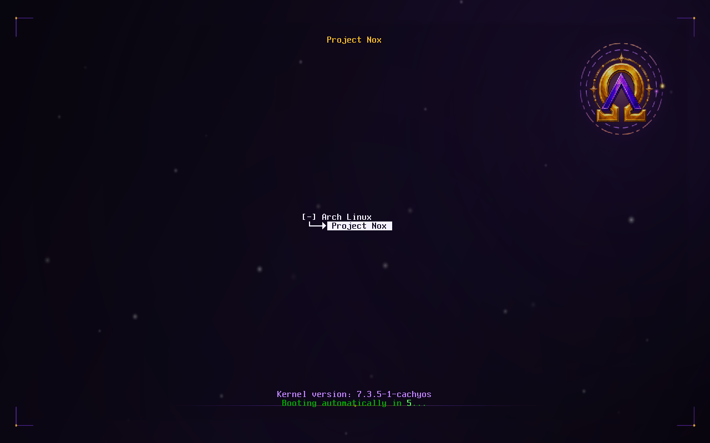
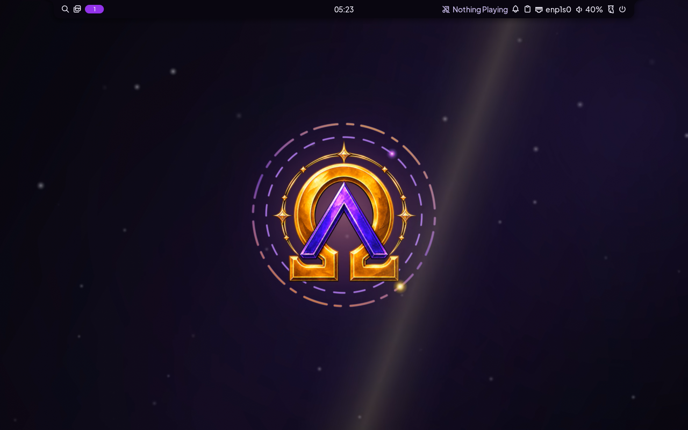

# Project Nox — Instalação Automatizada Pessoal para Arch Linux

> **Este é meu projeto pessoal de instalação automatizada e reprodução de um ambiente personalizado baseado no Arch Linux oficial.**  
> Ele foi criado para que eu consiga reinstalar meu próprio computador — com minhas configurações, aplicativos, aparência visual e ajustes de hardware — de maneira reproduzível a partir da ISO oficial do Arch Linux. O código está disponível publicamente para quem quiser estudar, adaptar ou replicar a estrutura, respeitando os requisitos de hardware e os riscos envolvidos.

---

## Sumário

1. [O que é o Project Nox](#1-o-que-é-o-project-nox)
2. [Principais características](#2-principais-características)
3. [Requisitos e compatibilidade (Hardware de referência)](#3-requisitos-e-compatibilidade-hardware-de-referência)
4. [Como instalar](#4-como-instalar)
5. [O que será instalado](#5-o-que-será-instalado)
6. [Capturas de tela reais](#6-capturas-de-tela-reais)
7. [Secure Boot (Guia Geral e Guia MSI PRO B650M-P)](#7-secure-boot-guia-geral-e-guia-msi-pro-b650m-p)
8. [Recuperação e limitações conhecidas](#8-recuperação-e-limitações-conhecidas)
9. [Avisos, créditos e licença](#9-avisos-créditos-e-licença)

---

## 1. O que é o Project Nox

O **Project Nox** (`Nox Archinstall`) **não** é uma distribuição Linux independente, **não** é um fork oficial do Arch Linux, **não** distribui uma imagem ISO própria e **não** é um produto comercial ou instalador universal garantido para qualquer computador. tampoco possui vínculo oficial com os projetos Arch Linux, CachyOS ou MSI.

Trata-se de uma automação construída sobre o **Arch Linux oficial** e o **`archinstall`** que:

- É executada diretamente a partir da **mídia de instalação (ISO) oficial do Arch Linux**.
- Apresenta um assistente interativo simplificado no terminal (`bootstrap/nox-install.py`), onde basta escolher o SSD de destino, o nome de usuário e a senha.
- Particiona e formata o disco selecionado em **Btrfs** com compressão `zstd:3` e subvolumes dedicados.
- Executa um pipeline offline de 13 etapas (`scripts/00-preflight.sh` a `scripts/90-first-boot.sh`) dentro do `arch-chroot`, validado por 55 verificações automáticas antes do primeiro boot.
- Entrega o sistema pronto para uso já no **primeiro login**, sem necessidade de pós-configuração manual de ambiente gráfico, dotfiles, áudio ou temas.

---

## 2. Principais características

- **Instalação guiada simplificada (`download-then-execute`):** sem precisar navegar pelos menus tradicionais do `archinstall`; exige apenas seleção e confirmação explícita do SSD, usuário e senha.
- **Base Arch Linux + Repositórios e Kernel CachyOS (`x86-64-v4` / `znver4`):** utiliza `linux-cachyos` como único kernel final instalado e repositórios CachyOS otimizados para arquiteturas AMD Zen 4/5 acima dos repositórios oficiais do Arch.
- **Bootloader Limine + Integridade BLAKE2B + Preparação para Secure Boot (`sbctl`):** menu Limine com identidade visual `Project Nox`, inscrição automática do hash BLAKE2B do `/boot/limine.conf` no binário EFI e geração individual de chaves `sbctl` locais na máquina instalada.
- **Armazenamento Btrfs com Snapshots e Rollback:** subvolumes `@`, `@home`, `@log`, `@pkg`, `@.snapshots` e `@swap`, integração `snap-pac` + `limine-snapper-sync` e política enxuta de retenção `PRE`/`POST`.
- **Ambiente Wayland Umbriel + Noctalia (`Obsidian Purple`):** compositor **Umbriel** com layout padrão `dwindle`, **Noctalia Shell**, **Noctalia Greeter** (`greetd`), **Noctalia Lock Screen** e wallpapers animados sincronizados via `mpvpaper`.

---

## 3. Requisitos e compatibilidade (Hardware de referência)

As escolhas de pacotes, parâmetros de kernel, topologia de monitores e regras de periféricos foram desenvolvidas especificamente para o computador pessoal de referência:

| Componente | Hardware de Referência do Projeto | Observação Técnica |
|---|---|---|
| **Placa-mãe** | **MSI PRO B650M-P** (`MS-7E27`, BIOS observada `1.I2`) | UEFI 64 bits (sem CSM/Legacy). Procedimento dedicado de Secure Boot documentado em [`docs/SECURE-BOOT-MSI.md`](docs/SECURE-BOOT-MSI.md). |
| **Processador (CPU)** | **AMD Ryzen 5 7500F** (Zen 4) | O preflight (`00-preflight.sh`) exige suporte à instrução **`x86-64-v4`** (Zen 4 / Zen 5) para uso dos repositórios `cachyos-znver4`. Não instalar em CPUs sem `x86-64-v4`. |
| **Placa de vídeo (GPU)** | **ASRock AMD Radeon RX 9060 XT** (Navi 44 / RDNA 4, PCI `1002:7590`) | Pilha aberta `amdgpu` + `mesa` + `vulkan-radeon` (RADV 64/32 bits) + `rocm-smi-lib`. |
| **Rede sem fio / Bluetooth** | **Intel Wi-Fi 6E AX210** | `NetworkManager` + `iwd`, domínio regulatório `BR`, ajuste `iwlwifi` e pilha BlueZ. |
| **Monitor principal** | **Samsung Odyssey G5** (`DP-1`, `2560x1440@165Hz`, horizontal à esquerda) | Identificado dinamicamente por EDID/conector via `nox-display-profile` (com fallback automático `Virtual-1` em VMs QEMU/KVM). |
| **Monitor secundário** | **AOC 24B35** (`HDMI-A-1`, `1920x1080@100Hz`, vertical 90° à direita) | Wallpaper animado sincronizado contínuo `G5 → AOC` via IPC `mpvpaper`. |
| **Áudio** | **Havit Fuxi H3** (dongle USB 2.4 GHz / Bluetooth) + microfone P2 | Regra udev e serviço PipeWire/WirePlumber (`nox-fuxi-h3-fix`) que corrige o volume PCM digital ao conectar o receptor sem sobrescrever mute intencional. |
| **Teclado** | **AULA F75** (layout ANSI US) | Configurado em `us` variante `intl` (`us-acentos` no console) com `.XCompose` para `ç`/`Ç` via `'` + `c`. |

> **Aviso de compatibilidade:** A instalação completa, o boot UEFI/OVMF, o Btrfs, o Limine, o Snapper, o Topgrade e o primeiro login gráfico foram homologados em máquinas virtuais isoladas **QEMU/KVM**. O comportamento específico de periféricos físicos (como os dois monitores reais conectados às portas da RX 9060 XT, o receptor USB do Fuxi H3 e o menu físico da BIOS MSI) depende do hardware real presente na máquina.

---

## 4. Como instalar

> **ATENÇÃO — OPERAÇÃO DESTRUTIVA:** O assistente de instalação **apagará todas as partições e dados do SSD selecionado**. Faça backup completo dos seus arquivos pessoais antes de prosseguir.

Consulte o guia passo a passo completo para iniciantes em **[`docs/INSTALLATION.md`](docs/INSTALLATION.md)**.

### Resumo rápido (na ISO oficial do Arch Linux)

1. Inicie o computador em modo **UEFI** a partir da ISO oficial do Arch Linux (homologado na ISO **`archlinux-2026.11.01-x86_64.iso`** com **`archinstall 4.5`**), mantendo o **Secure Boot desativado** durante o boot da ISO oficial.
2. Conecte-se à internet (cabo Ethernet automático ou Wi-Fi via `iwctl`).
3. No terminal `root@archiso`, execute o comando único de download e instalação interativa:

```bash
curl --proto '=https' --tlsv1.2 -fsSL https://raw.githubusercontent.com/Awerkori/arch-install/main/bootstrap/nox-install.py -o /tmp/nox-install.py && python3 /tmp/nox-install.py
```

4. No assistente interativo:
   - Informe o número do SSD de destino e digite o nome exato do dispositivo (por exemplo, `nvme0n1` ou `vda`) para confirmar a formatação.
   - Escolha seu nome de usuário em letras minúsculas (por exemplo, `awerkori`).
   - Digite sua senha duas vezes (ela também será utilizada pelo `sudo`; a conta `root` permanece bloqueada por segurança).
   - Confirme com `s` para iniciar a instalação automática e reinicie ao concluir.

---

## 5. O que será instalado

### 5.1. Sistema, Kernel e Desempenho
- **Base e Repositórios:** Arch Linux oficial combinado aos repositórios **`cachyos-znver4`**, **`cachyos-core-znver4`**, **`cachyos-extra-znver4`** e **`cachyos`** posicionados acima de `core`, `extra` e `multilib`, utilizando o fork `pacman` do CachyOS e o helper AUR estável `paru`.
- **Kernel único:** `linux-cachyos` + `linux-cachyos-headers` (qualquer kernel temporário do `pacstrap` inicial é removido de forma limpa antes da geração final do `initramfs`).
- **Escalonamento e Tuning:** `cachyos-settings`, `scx_loader` configurado com o escalonador BPF **`scx_lavd`** (modo `Gaming`), `ananicy-cpp`, `irqbalance`, `gamemode` e controle de congestionamento TCP **`bbr`** com disciplina de fila **`fq`**.
- **Gráficos:** `mesa`, `lib32-mesa`, `vulkan-radeon`, `lib32-vulkan-radeon` (`AMD_VULKAN_ICD=RADV`), `vulkan-tools`, `mesa-utils` e `rocm-smi-lib`.

### 5.2. Interface Gráfica e Identidade Visual (`Obsidian Purple`)
- **Compositor Wayland:** **Umbriel** com layout padrão **`dwindle`** em todos os monitores e workspaces.
- **Shell, Greeter e Lock Screen:** **Noctalia Shell**, **Noctalia Greeter** (via `greetd`) e **Noctalia Lock Screen**, unificados sob a paleta **Obsidian Purple** (`#09080d`, `#9d50ff`, `#e6c875`).
- **Wallpapers Animados:** reprodução contínua via `mpvpaper` com sincronização IPC entre o monitor principal e o secundário.
- **Temas e Fontes:** temas escuros integrados para GTK3/GTK4 e Qt5/Qt6 (`qt5ct`/`qt6ct`), cursor `Bibata-Modern-Ice`, ícones `Papirus-Dark` e fontes `Outfit`, `Plus Jakarta Sans` e `JetBrainsMono Nerd Font`.

### 5.3. Aplicativos Incluídos
- **Navegador padrão:** **Firefox** (pacote `firefox-pure` do CachyOS, apresentado como Firefox e configurado com tema escuro Obsidian).
- **Terminal padrão:** **Kitty** (com shell `bash` e painel visual inicial via `nox-fastfetch`).
- **Gerenciador de arquivos:** **Luciole** (`luciole-git`, compilado durante a instalação sob usuário temporário sem privilégios `noxbuild`).
- **Monitoramento e Manutenção:** **btop** (`btop++`), **Fastfetch**, **Topgrade** (`topgrade-bin`, integrado ao Snapper e ao ProtonPlus) e **ProtonPlus** com **`proton-cachyos-slr`** pré-instalado.
- **Launcher Minimalista:** menu principal do Noctalia (`Super`) exibe apenas os aplicativos essenciais do dia a dia (**Firefox**, **kitty**, **Luciole** e **ProtonPlus**), mantendo utilitários técnicos acessíveis via busca ou `/tools`.

### 5.4. Armazenamento, Memória e Recuperação
- **Particionamento GPT automático:** partição EFI (`/boot`, FAT32) de **4 GiB** + partição restante em **Btrfs** montada com `compress=zstd:3,discard=async,space_cache=v2`.
- **Subvolumes Btrfs:** `@` (`/`), `@home` (`/home`), `@log` (`/var/log`), `@pkg` (`/var/cache/pacman/pkg`), `@.snapshots` (`/.snapshots`) e `@swap` (`/nox-swap`).
- **Memória Swap:** **ZRAM** com compressão `zstd` (prioridade `100`) + **swapfile Btrfs NOCOW** (`+C`) em `/nox-swap/swapfile` (prioridade `10`, dimensionado automaticamente conforme a RAM/disco disponíveis) + `systemd-oomd`.
- **Snapshots e Bootloader:** **Snapper** (`root`) + `snap-pac` + `limine-snapper-sync` + hook `btrfs-overlayfs` no `mkinitcpio`, permitindo iniciar diretamente em snapshots pelo menu do **Limine** e restaurá-los com `nox-limine-snapper-restore`.

---

## 6. Capturas de tela reais

Capturas obtidas diretamente do sistema instalado pelo candidato aprovado (`final-v4`):

| Menu de Boot Limine (`Project Nox`) | Noctalia Greeter (Primeiro Boot) |
|---|---|
|  |  |

| Desktop no Primeiro Login (Umbriel + Noctalia + `mpvpaper`) | Launcher Minimalista do Noctalia (`Super`) |
|---|---|
|  |  |

| Noctalia Lock Screen (`Super + L`) |
|---|
|  |

---

## 7. Secure Boot (Guia Geral e Guia MSI PRO B650M-P)

O Project Nox gera chaves privadas exclusivas em `/var/lib/sbctl/keys/` durante cada instalação (nenhuma chave privada é distribuída neste repositório), inscreve o hash BLAKE2B do `/boot/limine.conf` no binário EFI do Limine e assina automaticamente o bootloader e o kernel `linux-cachyos`.

A ativação final do Secure Boot no firmware UEFI requer uma etapa consciente pós-instalação. Consulte a documentação detalhada antes de alterar qualquer opção da BIOS:

- 📘 **[`docs/SECURE-BOOT.md`](docs/SECURE-BOOT.md) — Guia Geral e Didático de Secure Boot:** explica todos os conceitos desde o básico (UEFI, PK, KEK, `db`, `dbx`, Setup Mode, Option ROM, `sbctl` e BLAKE2B do Limine) e apresenta o **Método A (Procedimento Geral Simples)** utilizando os helpers `nox-secureboot-enroll` e `nox-secureboot-verify`.
- 📗 **[`docs/SECURE-BOOT-MSI.md`](docs/SECURE-BOOT-MSI.md) — Guia Especializado para MSI PRO B650M-P (`MS-7E27`, BIOS `1.I2`, RX 9060 XT):** analisa em profundidade o estado de fábrica da MSI, a comparação técnica entre `--microsoft` e `--firmware-builtin`, a proteção da Option ROM/GOP da Radeon RX 9060 XT, o tratamento detalhado do alerta **`FQ0001`** (`Secure Boot Preset → Maximum Security` vs `Image Execution Policy`), os pontos obrigatórios de parada e relatos reais da comunidade Linux.

---

## 8. Recuperação e limitações conhecidas

### Manual de Recuperação
- 🛠️ **[`docs/RECOVERY.md`](docs/RECOVERY.md) — Manual Completo de Recuperação:** cobre 10 cenários reais de manutenção sem precisar formatar o PC (restauração de snapshots Snapper/Limine, reparo de assinatura EFI ou divergência BLAKE2B via `arch-chroot`, recuperação após ativação prematura do Secure Boot, tela preta de Option ROM e uso do jumper `JBAT1` / `Flash BIOS Button`).
- 📋 **[`docs/POST_INSTALL_CHECKS.md`](docs/POST_INSTALL_CHECKS.md) — Checklist Pós-Instalação em Hardware Físico:** comandos rápidos para conferir GPU, monitores, áudio Fuxi H3, Wi-Fi AX210, teclado e Topgrade/ProtonPlus na máquina real.

### Limitações conhecidas desta versão (`v1.0.0`)
1. **Ativação física do Secure Boot e alerta `FQ0001` na MSI:** o funcionamento criptográfico do `sbctl` + Limine foi homologado em UEFI OVMF com Secure Boot ativo, mas a aplicação da política `Maximum Security` / `Image Execution Policy` para mitigar o quirk `FQ0001` na placa física **MSI PRO B650M-P** depende de configuração presencial na BIOS pelo proprietário (veja [`docs/SECURE-BOOT-MSI.md`](docs/SECURE-BOOT-MSI.md)).
2. **Avatar no Noctalia Greeter:** o `noctalia-greeter` rodando sob o usuário `greeter` exibe o ícone vetorial padrão no cartão de login inicial antes da abertura da sessão do usuário, enquanto a Lock Screen e o Noctalia Shell dentro da sessão carregam o emblema animado personalizado.
3. **Janela residual durante restauração de snapshot sob queda de energia:** o wrapper `nox-limine-snapper-restore` só marca a transação de boot após a confirmação interativa e repara automaticamente `/boot/limine.conf` e as assinaturas EFI caso o usuário cancele com `Ctrl+C` ou no desligamento limpo do systemd; porém, uma queda abrupta de energia exatamente durante os poucos segundos da escrita em `/boot` pode exigir o reparo via `arch-chroot` documentado em [`docs/RECOVERY.md`](docs/RECOVERY.md).
4. **Versão da ISO e do `archinstall`:** o instalador valida por padrão a série homologada **`archinstall 4.5`** (presente na ISO oficial `archlinux-2026.11.01-x86_64.iso`).
5. **Escopo de hardware:** otimizações de compilação (`znver4` / `x86-64-v4`) e perfis de monitores/áudio foram feitos sob medida para o hardware pessoal listado na Seção 3.

---

## 9. Avisos, créditos e licença

- **Uso por sua conta e risco:** este repositório é disponibilizado sem garantias. Sempre revise o disco selecionado antes de confirmar a formatação.
- **Créditos e componentes de terceiros:** consulte **[`docs/CREDITS-AND-LICENSES.md`](docs/CREDITS-AND-LICENSES.md)** para a atribuição completa aos projetos upstream (Arch Linux, `archinstall`, CachyOS, Limine, `sbctl`, Snapper, Umbriel, Noctalia, Luciole, Kitty, Firefox, `mpvpaper`, Topgrade, ProtonPlus, fontes e temas).
- **Licença dos scripts e configurações próprias do repositório:** distribuídos sob a licença **[GNU AGPLv3](LICENSE)**.
