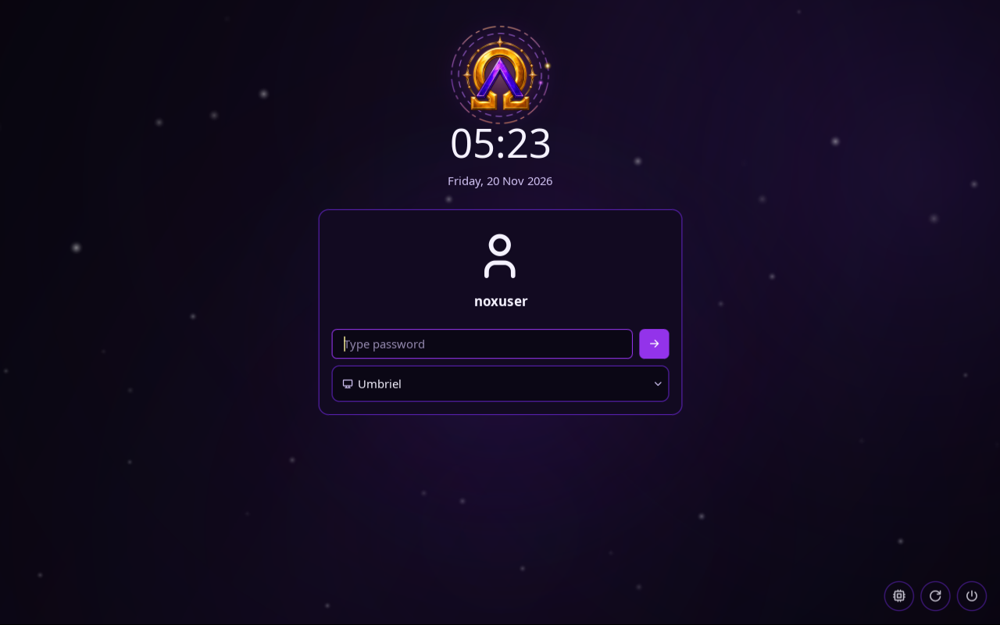

<p align="center">
  
</p>

<h1 align="center">Nox Archinstall</h1>

<p align="center">
  <em>Instalação pessoal automatizada de Arch Linux · Kernel CachyOS znver4, Limine, Btrfs Snapper, Secure Boot e Umbriel / Noctalia</em>
</p>

<p align="center">
  <a href="https://github.com/Awerkori/arch-install/releases/tag/v1.0.0"></a>
  
  
  <a href="LICENSE"></a>
</p>

<p align="center">
  
</p>

**Nox Archinstall** (internamente *Project Nox*) é o instalador pessoal e reproduzível do meu ambiente Arch Linux para hardware AMD Zen 4/5 (`x86-64-v4`), combinando o `archinstall 4.5` oficial a um pipeline pós-instalação modular que configura o sistema completo do disco ao desktop em uma única execução.

O ambiente entregue utiliza kernel único **`linux-cachyos`** otimizado para `znver4`, compositor Wayland **`Umbriel`** com **`Noctalia Shell`** na identidade visual **`Obsidian Purple`**, layout Btrfs resistente a falhas com rollback automático via **Snapper + `limine-snapper-sync`** e assinatura UEFI via **`sbctl`** com verificação **BLAKE2B** da configuração do Limine.

---

## Galeria do Sistema

| Bootloader Limine (`Project Nox`) | Login Gráfico (`Noctalia Greeter`) |
| :---: | :---: |
|  |  |
| **Launcher Minimalista (`Obsidian Purple`)** | **Bloqueio de Sessão (`Noctalia Lock Screen`)** |
|  |  |

---

## O Que É Instalado

| Camada | Especificação Principal |
|---|---|
| **Base & Kernel** | Arch Linux + repositórios `cachyos-znver4` e `linux-cachyos` único (`kernel_count=1`, `zram0` + swapfile NOCOW) |
| **Particionamento** | GPT UEFI (`/boot` 4 GiB FAT32 + Btrfs `zstd:3` com `@`, `@home`, `@log`, `@pkg`, `@.snapshots`, `@swap`) |
| **Boot & Integridade** | **Limine** com verificação BLAKE2B de `limine.conf`/kernel/initramfs + `nox-limine-integrity` e `sbctl` (5 etapas) |
| **Snapshots & Rollback** | **Snapper** (`root`, máx. 2 snapshots `PRE`+`POST`) + `snap-pac` + `limine-snapper-sync` + `nox-limine-snapper-restore` |
| **Desktop & Apps** | **Umbriel** (`dwindle`), **Noctalia Shell**, `mpvpaper`, **Kitty**, **Luciole**, **Firefox Pure** e `nox-topgrade` + `ProtonPlus` |

---

## Como Instalar (`v1.0.0` Estável Publicada)

> **Estado das versões:** a release atualmente **publicada e disponível para download imediato** é a **[`v1.0.0`](https://github.com/Awerkori/arch-install/releases/tag/v1.0.0)**. A revisão **`v1.0.1`** permanece em homologação no [PR #1](https://github.com/Awerkori/arch-install/pull/1) (branch `hardening/v1.0.1`, ainda **não publicada**; sua cadeia determinística para o lançamento futuro está documentada em [`manifests/release.json`](manifests/release.json)).

Na **ISO oficial do Arch Linux** (`archlinux-2026.11.01-x86_64.iso`, modo UEFI 64 bits, com Secure Boot desativado temporariamente na BIOS e rede conectada), execute **este único comando oficial verificado da release publicada `v1.0.0`**:

```bash
(umask 077; curl --proto '=https' --proto-redir '=https' --tlsv1.2 -fsSL https://github.com/Awerkori/arch-install/releases/download/v1.0.0/nox-install.py -o /tmp/nox-install.py) && \
printf '%s  /tmp/nox-install.py\n' 'fce3f9a83e2b8c13666cf583f143096de37b8dd312e59dd8c6af4acbabb82f10' | sha256sum -c - && \
(umask 077; curl --proto '=https' --proto-redir '=https' --tlsv1.2 -fsSL https://github.com/Awerkori/arch-install/releases/download/v1.0.0/user_configuration.json -o /tmp/nox-cfg.json) && \
printf '%s  /tmp/nox-cfg.json\n' '6754aefcdfb659e1abdfb5036c158a609d1672f945186a1e692edeab2e104e4c' | sha256sum -c - && \
umask 022 && \
python3 /tmp/nox-install.py --config /tmp/nox-cfg.json && \
rm -f /tmp/nox-install.py /tmp/nox-cfg.json
```

O assistente solicita **5 confirmações interativas** antes de tocar no SSD (`[1/4]` escolha do SSD → `[2/4]` nome exato do dispositivo para apagar → `[3/4]` usuário → `[4/4]` senha + confirmação → confirmação final `[s/N]`). Ao término, execute `reboot`, remova o pendrive e consulte [`docs/INSTALLATION.md`](docs/INSTALLATION.md) para detalhes completos (Wi-Fi via `iwctl`, primeiro boot e inspeção passo a passo).

---

## Documentação

| Guia | Assunto |
|---|---|
| [`docs/INSTALLATION.md`](docs/INSTALLATION.md) | Passo a passo completo da instalação, Wi-Fi na ISO e hashes verificados |
| [`docs/KEYBINDS_MIGRATION.md`](docs/KEYBINDS_MIGRATION.md) | Atalhos completos do compositor **Umbriel** e launcher **Noctalia** |
| [`docs/SECURE-BOOT-MSI.md`](docs/SECURE-BOOT-MSI.md) | Guia específico para **MSI PRO B650M-P** (`FQ0001`, `--microsoft`, `JBAT1`, Fases A–E) |
| [`docs/SECURE-BOOT.md`](docs/SECURE-BOOT.md) | Arquitetura geral de **Secure Boot**, `sbctl` e fluxo de 5 etapas |
| [`docs/RECOVERY.md`](docs/RECOVERY.md) | Manual de recuperação em 10 cenários (snapshots, `limine.conf`, `arch-chroot`) |
| [`docs/POST_INSTALL_CHECKS.md`](docs/POST_INSTALL_CHECKS.md) | Verificações físicas pós-instalação (`RX 9060 XT`, monitores, `AX210`, `Fuxi H3`) |
| [`docs/INSTALLED-COMPONENTS.md`](docs/INSTALLED-COMPONENTS.md) | Inventário de pacotes (`711` pacotes em [`INSTALLED-PACKAGES.tsv`](docs/INSTALLED-PACKAGES.tsv)) e unidades |
| [`docs/TOPGRADE-PROTON-INTEGRATION.md`](docs/TOPGRADE-PROTON-INTEGRATION.md) | Atualizações unificadas (`nox-topgrade` + `paru` + `ProtonPlus` + Proton-CachyOS) |
| [`docs/FINAL-AUDIT-REPORT.md`](docs/FINAL-AUDIT-REPORT.md) | Relatório de auditoria, testes de contrato e homologação em VMs limpas (`v1.0.1`) |
| [`docs/CREDITS-AND-LICENSES.md`](docs/CREDITS-AND-LICENSES.md) | Separação entre automação própria e projetos upstream |

---

## Limitações Conhecidas

- **Hardware-alvo específico:** exige CPU compatível com **`x86-64-v4`** (AMD Zen 4 / Zen 5) e firmware **UEFI 64 bits**; perfil calibrado para **MSI PRO B650M-P (`MS-7E27`)**, **Ryzen 5 7500F**, **Radeon RX 9060 XT**, **Intel AX210** e monitores Samsung Odyssey G5 + AOC 24B35.
- **Homologação em VM vs. hardware físico:** toda a cadeia ponta a ponta foi validada em VMs QEMU/KVM OVMF (incluindo Secure Boot ativo e rollback durável PRE com preservação de `/home`); verificações de GPU dedicada, monitores DP/HDMI, Wi-Fi/Bluetooth reais, headset Havit Fuxi H3 e `FQ0001` na BIOS MSI estão listadas como `PENDENTE-HARDWARE` em [`docs/POST_INSTALL_CHECKS.md`](docs/POST_INSTALL_CHECKS.md).
- **Modelo de confiança:** sem chave PGP offline pré-instalada na ISO oficial do Arch Linux, a integridade apoia-se em HTTPS/TLSv1.2+ sem downgrade e verificação explícita de hashes **SHA-256**.

---

## Créditos e Licença

O código de automação, scripts, wrappers e identidade visual originais deste repositório são licenciados sob a **[GNU Affero General Public License v3.0 (AGPL-3.0)](LICENSE)**. Todos os créditos pelos projetos integrados pertencem aos respectivos autores e comunidades: **Arch Linux**, **CachyOS**, **Limine**, **Umbriel**, **Noctalia Shell**, **sbctl**, **Snapper**, **snap-pac**, **limine-snapper-sync**, **Topgrade** e **ProtonPlus** — relação completa em [`docs/CREDITS-AND-LICENSES.md`](docs/CREDITS-AND-LICENSES.md).
