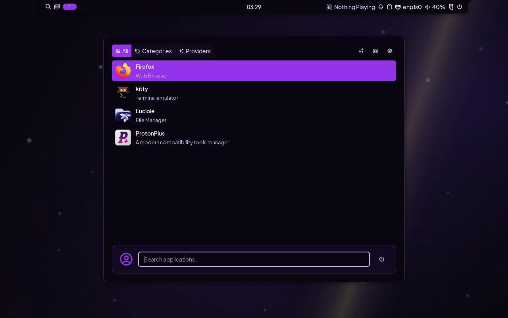

<p align="center">
  
</p>

<h1 align="center">Nox Archinstall</h1>

<p align="center">
  <strong>Minha instalação pessoal e reproduzível do Arch Linux</strong>
</p>

<p align="center">
  <a href="https://github.com/Awerkori/arch-install/actions/workflows/ci.yml"></a>
  <a href="https://github.com/Awerkori/arch-install/releases/tag/v1.0.0"></a>
  <a href="LICENSE"></a>
  <a href="#hardware-utilizado"></a>
</p>

<p align="center">
  <a href="#sobre">Sobre</a> ·
  <a href="#desktop-e-interface">Desktop</a> ·
  <a href="#sistema-e-aplicativos">Sistema e aplicativos</a> ·
  <a href="#armazenamento-e-boot">Armazenamento e boot</a> ·
  <a href="#hardware-utilizado">Hardware</a> ·
  <a href="#instalação">Instalação</a> ·
  <a href="#secure-boot-e-documentação">Secure Boot</a> ·
  <a href="#créditos-e-licença">Créditos</a>
</p>

O **Nox Archinstall** é meu projeto pessoal de instalação automatizada do Arch Linux. Criei este repositório para conseguir reinstalar meu computador com os programas, atalhos, aparência e ajustes de sistema que uso no dia a dia, sem precisar refazer tudo manualmente a cada formatação.

O projeto roda diretamente a partir da ISO oficial do Arch Linux e foi feito sob medida para o meu hardware de referência (não é uma distribuição genérica homologada para qualquer computador). Deixei o código aberto para quem quiser estudar, adaptar ou aproveitar partes da configuração.


## Sobre

Sempre que eu formatava o PC, precisava repetir a mesma rotina: particionar o SSD em Btrfs, criar subvolumes, adicionar os repositórios do CachyOS, configurar o Limine, instalar o ambiente Wayland, alinhar os dois monitores, acertar o volume do headset USB e aplicar temas escuros em cada programa.

Para automatizar esse processo com segurança, montei um assistente interativo no terminal ([`bootstrap/nox-install.py`](bootstrap/nox-install.py)) que conduz cinco etapas antes de tocar no disco:

1. Escolha do SSD de destino na lista de discos elegíveis (a mídia live da ISO é filtrada automaticamente).
2. Confirmação destrutiva digitando exatamente o nome curto do dispositivo selecionado (ex.: `nvme0n1`).
3. Definição do nome do usuário principal (adicionado ao grupo `wheel`).
4. Definição e confirmação da senha com entrada oculta (utilizada tanto pelo usuário quanto pelo `sudo`, mantendo a conta `root` bloqueada).
5. Confirmação final do resumo antes de iniciar a formatação.

A partir daí, a instalação particiona o disco, valida criptograficamente o pacote da versão por SHA-256, instala os pacotes oficiais e entrega o sistema pronto logo no primeiro boot.

## Desktop e interface

O ambiente gráfico usa o compositor Wayland **Umbriel** (configurado no layout `dwindle`) junto com o **Noctalia Shell**, o **Noctalia Greeter** (`greetd`) e a **Noctalia Lock Screen**. Toda a interface segue o tema escuro **Obsidian Purple**, com fundo escuro (`#090610`) e detalhes em roxo e dourado que se mantêm do menu de boot até o terminal, aplicativos GTK/Qt e navegador.

Nos dois monitores, o `mpvpaper` reproduz wallpapers animados sincronizados entre a tela principal horizontal e a tela secundária vertical. O menu de aplicativos do Noctalia (`Super`) foi configurado para mostrar inicialmente apenas os quatro programas de uso diário (`Firefox`, `kitty`, `Luciole` e `ProtonPlus`), deixando utilitários técnicos de configuração acessíveis pela busca ou pelo prefixo `/tools`.

| Menu de boot (Limine) | Tela de login (Noctalia Greeter) |
|---|---|
|  |  |

| Launcher de aplicativos | Tela de bloqueio (Lock Screen) |
|---|---|
|  |  |

Atalhos principais no uso diário (mapa completo em [`docs/KEYBINDS_MIGRATION.md`](docs/KEYBINDS_MIGRATION.md)):
- `Super` ou `Super + R`: abre o launcher de aplicativos do Noctalia.
- `Super + Q`: abre o terminal **Kitty**.
- `Super + E` ou `Ctrl + E`: abre o gerenciador de arquivos **Luciole**.
- `Super + C`: fecha a janela focada.
- `Super + L`: bloqueia a sessão com a **Noctalia Lock Screen**.

## Sistema e aplicativos

Sobre a base oficial do **Arch Linux**, o sistema utiliza exclusivamente o kernel **`linux-cachyos`** (removendo kernels temporários de bootstrap) e os repositórios do **CachyOS** compilados para processadores **AMD Zen 4 (`x86-64-v4`)**, com o gerenciador `pacman` do CachyOS e o `paru`. A parte gráfica roda sobre a pilha aberta **AMD Mesa/RADV** (64 e 32 bits), acompanhada do escalonador `scx_lavd` (`scx_loader`), `ananicy-cpp`, `irqbalance`, `GameMode`, `NetworkManager` (`iwd`), áudio **PipeWire / WirePlumber**, `initramfs` gerada com `mkinitcpio` (`zstd` + `sd-btrfs-overlayfs`) e controle de congestionamento TCP `BBR` com fila `fq`.

Programas incluídos por padrão (inventário completo dos 711 pacotes em [`docs/INSTALLED-COMPONENTS.md`](docs/INSTALLED-COMPONENTS.md) e [`docs/INSTALLED-PACKAGES.tsv`](docs/INSTALLED-PACKAGES.tsv)):

- **Dia a dia:** **Firefox** (`firefox-pure` do CachyOS, exibido como Firefox e configurado como navegador padrão HTTP/HTTPS), **Kitty** (terminal principal com shell **Bash** e locale `en_CA.UTF-8`) e **Luciole** (`luciole-git`, gerenciador de arquivos).
- **Monitoramento e atualização:** **Fastfetch** (painel do sistema no terminal), **btop** (`rocm-smi-lib`) e **Topgrade** (atualização unificada com proteção `flock`, integrada ao `paru`, ao Snapper e ao ProtonPlus — detalhes em [`docs/TOPGRADE-PROTON-INTEGRATION.md`](docs/TOPGRADE-PROTON-INTEGRATION.md)).
- **Jogos:** **ProtonPlus** com a camada **`proton-cachyos-slr`** pré-instalada.

## Armazenamento e boot

O SSD é formatado em **GPT** com uma partição EFI (`/boot`) de **4 GiB** em FAT32 e uma partição raiz em **Btrfs** com compressão `zstd:3`, dividida em seis subvolumes independentes:
- `@` (`/`) — sistema raiz protegido por snapshots.
- `@home` (`/home`) — arquivos pessoais isolados de rollbacks do sistema.
- `@log` (`/var/log`) e `@pkg` (`/var/cache/pacman/pkg`) — logs e cache de pacotes isolados dos snapshots da raiz.
- `@.snapshots` (`/.snapshots`) — armazenamento dos snapshots do Snapper.
- `@swap` (`/nox-swap`) — subvolume dedicado para o **swapfile Btrfs NOCOW** (`+C`, prioridade 10), combinado com **ZRAM** em RAM (`zstd`, prioridade 100) e proteção `systemd-oomd`.

Antes e depois de atualizações via `pacman`, `paru` ou `topgrade`, o **Snapper** e o `snap-pac` mantêm somente o par gerenciado `PRE`/`POST` mais recente do sistema raiz (preservando snapshots manuais e nunca removendo o último ponto de recuperação válido se uma transação for interrompida). O `limine-snapper-sync` e o `nox-limine-normalize` expõem esses pontos diretamente no menu do bootloader **Limine** (`Ponto de Segurança` e `Estado Atualizado`).

## Hardware utilizado

> **Aviso de escopo:** O Nox Archinstall foi projetado para o computador pessoal listado abaixo. A instalação completa é validada em máquinas virtuais QEMU/KVM (`ACCEPT-A` e `ACCEPT-B`), mas o funcionamento em outros computadores físicos não foi testado.

| Componente | Modelo |
|---|---|
| Processador | AMD Ryzen 5 7500F (Zen 4, sem vídeo integrado) |
| Placa-mãe | MSI PRO B650M-P (`MS-7E27`) |
| Placa de vídeo | ASRock AMD Radeon RX 9060 XT |
| Wi-Fi / Bluetooth | Intel AX210 (`iwlwifi`) |
| Monitor principal | Samsung Odyssey G5 (`2560x1440@165Hz`, `DP-1`) |
| Monitor secundário | AOC 24B35 (`1920x1080@100Hz`, vertical 90°, `HDMI-A-1`) |
| Headset | Havit Fuxi H3 |
| Teclado | AULA F75 (`us-intl` com `ç` via `.XCompose`) |

O instalador exige processador compatível com **`x86-64-v4`** (verificado em `00-preflight.sh`), inicialização em **UEFI 64 bits** e a ISO oficial homologada **`archlinux-2026.11.01-x86_64.iso`** (`archinstall 4.5`), além de bloquear execução acidental fora da mídia live (`/run/archiso`).

## Instalação

> **Atenção: o disco selecionado será integralmente formatado e todos os dados nele existentes serão apagados. Faça backup antes de continuar.**

Todas as etapas da cadeia oficial de instalação utilizam **referências imutáveis por commit SHA** e **verificação independente de hash SHA-256** antes de executar ou interpretar qualquer arquivo remoto:

1. **Estágio 1 ([`i`](i)):** baixado por HTTPS estrito de commit imutável e verificado por SHA-256 no terminal antes de ser executado pelo `sh`.
2. **Estágio 2 ([`bootstrap/nox-install.py`](bootstrap/nox-install.py)):** baixado pelo iniciador `i` de commit imutável e verificado por SHA-256 antes de iniciar o Python.
3. **Estágio 3 ([`user_configuration.json`](user_configuration.json)):** baixado de commit imutável e verificado por SHA-256 (`OFFICIAL_CONFIG_SHA256`) antes do parse JSON.
4. **Estágio 4 (`nox-archinstall-payload-v1.0.1.tar.gz`):** baixado por HTTPS sem downgrade de redirecionamento e verificado por SHA-256 (`6e9500f44ce9c4882db27e91e20aa3e276499d3f1681ed0872c92dae696a2509`) antes de qualquer extração no sistema-alvo. *(A release estável atualmente publicada é a `v1.0.0`; os artefatos `v1.0.1` da branch `hardening/v1.0.1` aguardam aprovação humana para publicação.)*

### Passo a passo rápido na ISO oficial

1. Inicie o computador pela ISO oficial **`archlinux-2026.11.01-x86_64.iso`** em modo **UEFI** (com o **Secure Boot desativado** na BIOS).
2. Conecte-se à internet (cabo Ethernet ou Wi-Fi via `iwctl`).
3. Execute o comando oficial verificado abaixo (baixa o iniciador `i` do commit imutável, confere o SHA-256 e só então inicia o assistente):

```bash
sh -c 'set -eu; umask 077; f=$(mktemp /tmp/nox-i.XXXXXX); trap "rm -f \"$f\"" EXIT INT TERM; curl --proto "=https" --proto-redir "=https" --tlsv1.2 -fsSL https://raw.githubusercontent.com/Awerkori/arch-install/058c37de6279d427c8d902bde47e124d6a671106/i -o "$f"; printf "%s  %s\n" "36ce94494db9fb13caad373fa13ed55b8f2d6b15ed4dac8f3b4827ecb687ad11" "$f" | sha256sum -c -; sh "$f"'
```

Se preferir inspecionar o iniciador manualmente antes de executá-lo, utilize a sequência passo a passo (que aplica exatamente a mesma verificação de integridade):

```bash
umask 077
curl --proto '=https' --proto-redir '=https' --tlsv1.2 -fsSL https://raw.githubusercontent.com/Awerkori/arch-install/058c37de6279d427c8d902bde47e124d6a671106/i -o /tmp/nox-i
printf '%s  /tmp/nox-i\n' '36ce94494db9fb13caad373fa13ed55b8f2d6b15ed4dac8f3b4827ecb687ad11' | sha256sum -c -
less /tmp/nox-i
sh /tmp/nox-i
rm -f /tmp/nox-i
```

Para instruções completas (incluindo preparação do pendrive, conexão Wi-Fi, verificação dos hashes da release estável `v1.0.0` e primeiro boot), consulte o **[Guia de Instalação (`docs/INSTALLATION.md`)](docs/INSTALLATION.md)**.

## Secure Boot e documentação

O projeto separa claramente as **cinco etapas** do ciclo de vida do Secure Boot (verificadas pelo utilitário `nox-secureboot-verify`):

1. **Preparação das chaves locais:** geração de chaves privadas exclusivas da máquina em `/var/lib/sbctl/keys/` durante a instalação (`sbctl create-keys`).
2. **Assinatura dos binários:** assinatura PE/EFI de `/boot/EFI/limine/limine_x64.efi`, `/boot/EFI/BOOT/BOOTX64.EFI` e do kernel `vmlinuz`.
3. **Integridade da configuração do Limine:** verificação dos hashes **BLAKE2B** de todos os arquivos referenciados em `/boot/limine.conf` e inscrição do hash BLAKE2B do próprio `limine.conf` dentro dos binários EFI do Limine (`nox-limine-integrity`).
4. **Enrollment das chaves no firmware UEFI:** gravação das chaves na NVRAM em *Setup Mode* via `sudo nox-secureboot-enroll --yes-enroll-uefi-keys` (preservando os certificados Microsoft UEFI CA `--microsoft` para não bloquear a Option ROM da GPU dedicada Radeon RX 9060 XT em um processador sem vídeo integrado).
5. **Secure Boot efetivamente ativo na UEFI:** habilitação final na BIOS da placa-mãe e comprovação com `sudo nox-secureboot-verify --require-active`.

Manuais e relatórios técnicos do repositório:
- **Guia de instalação passo a passo:** [`docs/INSTALLATION.md`](docs/INSTALLATION.md)
- **Guia geral de Secure Boot:** [`docs/SECURE-BOOT.md`](docs/SECURE-BOOT.md)
- **Guia específico para MSI PRO B650M-P + RX 9060 XT (`FQ0001`):** [`docs/SECURE-BOOT-MSI.md`](docs/SECURE-BOOT-MSI.md)
- **Manual de recuperação (10 cenários):** [`docs/RECOVERY.md`](docs/RECOVERY.md)
- **Checklist pós-instalação no hardware físico (`PENDENTE-HARDWARE`):** [`docs/POST_INSTALL_CHECKS.md`](docs/POST_INSTALL_CHECKS.md)
- **Relatório de auditoria e hardening (`v1.0.1`):** [`docs/FINAL-AUDIT-REPORT.md`](docs/FINAL-AUDIT-REPORT.md) (histórico em [`docs/history/`](docs/history/FINAL-AUDIT-REPORT-v1.0.0.md))
- **Manifesto de integridade da versão:** [`manifests/release.json`](manifests/release.json)

## Créditos e licença

Este projeto utiliza e configura softwares desenvolvidos pelas comunidades do **Arch Linux**, **`archinstall`**, **CachyOS**, **Limine**, **`sbctl`**, **Snapper**, **Umbriel**, **Noctalia**, **Luciole**, **Kitty**, **Firefox**, **`mpvpaper`**, **btop**, **Fastfetch**, **Topgrade** e **ProtonPlus**. Os créditos detalhados e as licenças de cada componente estão em [`docs/CREDITS-AND-LICENSES.md`](docs/CREDITS-AND-LICENSES.md).

Os scripts e configurações próprios deste repositório são distribuídos sob a licença **[GNU AGPLv3](LICENSE)**.
