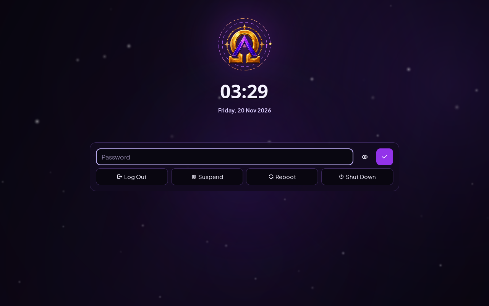

<p align="center">
  
</p>

<h1 align="center">Nox Archinstall</h1>

<p align="center">
  <strong>Minha instalação pessoal do Arch Linux</strong>
</p>

<p align="center">
  <a href="#sobre">Sobre</a> ·
  <a href="#desktop-e-interface">Desktop</a> ·
  <a href="#sistema-e-aplicativos">Sistema e aplicativos</a> ·
  <a href="#armazenamento-e-boot">Armazenamento e boot</a> ·
  <a href="#hardware-utilizado">Hardware</a> ·
  <a href="#instalação">Instalação</a> ·
  <a href="#secure-boot-e-documentação">Secure Boot</a> ·
  <a href="#créditos-e-licença">Créditos</a>
</p>

O **Nox Archinstall** é meu projeto pessoal de instalação automatizada do Arch Linux. Criei este repositório para conseguir reinstalar meu computador com os programas, atalhos, aparência e ajustes de sistema que uso no dia a dia, sem precisar refazer tudo manualmente a cada formatação.

O projeto roda diretamente a partir da ISO oficial do Arch Linux e foi feito sob medida para a minha máquina. Deixei o código aberto para quem quiser estudar, adaptar ou aproveitar partes da configuração, mas ele não foi testado em outros computadores físicos.


---

## Sobre

Sempre que eu formatava o PC, precisava repetir a mesma rotina: particionar o SSD em Btrfs, criar subvolumes, adicionar os repositórios do CachyOS, configurar o Limine, instalar o ambiente Wayland, alinhar os dois monitores, acertar o volume do headset USB e aplicar temas escuros em cada programa.

Para resolver isso de forma simples, montei um assistente no terminal (`bootstrap/nox-install.py`) que faz apenas três perguntas — qual SSD será formatado, qual será o nome de usuário e qual será a senha. A partir daí, a instalação particiona o disco, baixa os pacotes oficiais e entrega o sistema pronto logo no primeiro boot.

---

## Desktop e interface

O ambiente gráfico usa o compositor Wayland **Umbriel** (configurado no layout `dwindle`) junto com o **Noctalia Shell**, o **Noctalia Greeter** (`greetd`) e a **Noctalia Lock Screen**. Toda a interface segue o tema escuro **Obsidian Purple**, com fundo escuro (`#09080d`) e detalhes em roxo e dourado que se mantêm do menu de boot até o terminal, aplicativos GTK/Qt e navegador.

Nos dois monitores, o `mpvpaper` reproduz wallpapers animados sincronizados entre a tela principal horizontal e a tela secundária vertical. O menu de aplicativos do Noctalia (`Super`) foi configurado para mostrar inicialmente apenas os programas de uso diário, deixando utilitários técnicos de configuração acessíveis pela busca ou pelo comando `/tools`.

| Menu de boot (Limine) | Tela de login (Noctalia Greeter) |
|---|---|
|  |  |

| Launcher de aplicativos | Tela de bloqueio (Lock Screen) |
|---|---|
|  |  |

---

## Sistema e aplicativos

Sobre a base oficial do **Arch Linux**, o sistema utiliza o kernel **`linux-cachyos`** (como único kernel instalado) e os repositórios do **CachyOS** compilados para processadores **AMD Zen 4 (`x86-64-v4`)**, com o gerenciador `pacman` do CachyOS e o `paru`. A parte gráfica roda sobre a pilha aberta **AMD Mesa/RADV** (64 e 32 bits), acompanhada do escalonador `scx_lavd` (`scx_loader`), `ananicy-cpp`, `irqbalance`, `GameMode`, `NetworkManager` (`iwd`) e controle de congestionamento TCP `BBR` com fila `fq`.

Programas incluídos por padrão:

- **Dia a dia:** **Firefox** (`firefox-pure` do CachyOS, exibido como Firefox), **Kitty** (terminal principal com `bash`) e **Luciole** (`luciole-git`, gerenciador de arquivos).
- **Monitoramento e atualização:** **Fastfetch** (resumo do sistema ao abrir o terminal), **btop** e **Topgrade** (atualização geral integrada aos snapshots do Snapper e ao ProtonPlus).
- **Jogos:** **ProtonPlus** com a camada **`proton-cachyos-slr`** pré-instalada.

---

## Armazenamento e boot

O SSD é formatado em **Btrfs** com compressão `zstd:3` e dividido em subvolumes independentes (`@`, `@home`, `@log`, `@pkg`, `@.snapshots` e `@swap`), separando o sistema raiz dos arquivos pessoais em `/home`. Para memória virtual, o sistema combina **ZRAM** comprimida em RAM (`zstd`, prioridade alta) com um **swapfile Btrfs NOCOW** dedicado em disco e proteção `systemd-oomd`.

Antes e depois de atualizações de pacotes ou execuções do Topgrade, o **Snapper** cria snapshots automáticos (`PRE`/`POST`) e os envia para o menu do bootloader **Limine**, permitindo iniciar o sistema diretamente em um snapshot anterior se algo der errado. O Limine também verifica o hash **BLAKE2B** do arquivo `/boot/limine.conf` e já deixa os binários EFI e o kernel assinados com chaves locais geradas pelo **`sbctl`** durante a instalação.

---

## Hardware utilizado

**O Nox Archinstall foi desenvolvido especificamente para o computador pessoal abaixo. A instalação foi testada em máquinas virtuais, mas seu funcionamento em outros computadores físicos ainda não foi comprovado.**

| Componente | Modelo |
|---|---|
| Processador | AMD Ryzen 5 7500F |
| Placa-mãe | MSI PRO B650M-P |
| Placa de vídeo | Radeon RX 9060 XT |
| Wi-Fi / Bluetooth | Intel AX210 |
| Monitor principal | Samsung Odyssey G5 |
| Monitor secundário | AOC 24B35 |
| Headset | Havit Fuxi H3 |
| Teclado | AULA F75 |

Vários ajustes do repositório foram pensados especificamente para essas peças: repositórios que exigem instruções `x86-64-v4` (Zen 4), drivers AMD RADV, posição automática do Samsung Odyssey G5 (`2560x1440@165Hz` em `DP-1`) ao lado do AOC vertical (`1920x1080@100Hz` rotacionado a 90° em `HDMI-A-1`), correção de volume digital ao conectar o receptor USB do Havit Fuxi H3 e layout de teclado `us-intl` com `ç` para o AULA F75. Os pré-requisitos obrigatórios estão descritos em [`docs/INSTALLATION.md`](docs/INSTALLATION.md).

---

## Instalação

> **Atenção: o disco selecionado será formatado e seus dados serão apagados. Faça backup antes de continuar.**

O assistente pergunta qual SSD será utilizado, o nome do seu usuário e a senha (que também autoriza o `sudo`, mantendo a conta `root` bloqueada e configurando o hostname padrão `Nox-Device-PC`). Todo o restante da instalação acontece automaticamente.

1. Baixe a ISO oficial do Arch Linux compatível (`archlinux-2026.11.01-x86_64.iso`, com `archinstall 4.5`).
2. Inicie o computador pelo pendrive em modo **UEFI** (com o **Secure Boot desativado** na BIOS).
3. Conecte-se à internet (por cabo de rede ou pelo Wi-Fi usando `iwctl`).
4. No terminal da ISO, execute o **comando curto** abaixo para baixar o iniciador oficial do repositório, validar o SHA-256 do instalador e abrir o assistente:

```bash
curl -fsSL https://github.com/Awerkori/arch-install/raw/main/i | sh
```

Se preferir baixar o script Python manualmente em duas etapas sem usar o atalho `/raw/main/i`, utilize o **comando completo original** (ambos iniciam exatamente o mesmo instalador):

```bash
curl --proto '=https' --tlsv1.2 -fsSL https://raw.githubusercontent.com/Awerkori/arch-install/main/bootstrap/nox-install.py -o /tmp/nox-install.py && python3 /tmp/nox-install.py
```

5. Escolha o SSD na lista, digite o nome do dispositivo para confirmar, informe usuário e senha e aguarde a conclusão antes de reiniciar.

Para instruções passo a passo sobre preparação do pendrive, conexão Wi-Fi e primeiro boot, consulte o **[Guia de Instalação (`docs/INSTALLATION.md`)](docs/INSTALLATION.md)**.

---

## Secure Boot e documentação

As chaves locais do `sbctl` e a assinatura do Limine e do kernel já são preparadas durante a instalação, mas a ativação do Secure Boot exige configuração posterior na BIOS da placa-mãe.

- **Guia geral de Secure Boot — [`docs/SECURE-BOOT.md`](docs/SECURE-BOOT.md)**  
  Explica o funcionamento das chaves UEFI (`PK`, `KEK`, `db`, `dbx`, Setup Mode, Option ROM e BLAKE2B) e o procedimento geral simplificado do projeto.

- **Guia específico para MSI PRO B650M-P — [`docs/SECURE-BOOT-MSI.md`](docs/SECURE-BOOT-MSI.md)**  
  Detalha o procedimento para a placa-mãe MSI PRO B650M-P com o Ryzen 5 7500F (sem vídeo integrado) e a Radeon RX 9060 XT, incluindo chaves Microsoft/OEM, Setup Mode, proteção da Option ROM da GPU e correção do alerta `FQ0001`.

- **Guia de recuperação — [`docs/RECOVERY.md`](docs/RECOVERY.md)**  
  Procedimentos passo a passo para recuperar o boot pela ISO oficial, restaurar snapshots do Snapper/Limine, ressincronizar assinaturas EFI e resetar o CMOS.

Outros documentos do repositório:
- **Checklist pós-instalação no hardware físico:** [`docs/POST_INSTALL_CHECKS.md`](docs/POST_INSTALL_CHECKS.md)
- **Mapa de atalhos de teclado:** [`docs/KEYBINDS_MIGRATION.md`](docs/KEYBINDS_MIGRATION.md)

---

## Créditos e licença

Este projeto utiliza e configura softwares desenvolvidos pelas comunidades do **Arch Linux**, **`archinstall`**, **CachyOS**, **Limine**, **`sbctl`**, **Snapper**, **Umbriel**, **Noctalia**, **Luciole**, **Kitty**, **Firefox**, **`mpvpaper`**, **btop**, **Fastfetch**, **Topgrade** e **ProtonPlus**. Os créditos detalhados e as licenças de cada componente estão em [`docs/CREDITS-AND-LICENSES.md`](docs/CREDITS-AND-LICENSES.md).

Os scripts e configurações próprios deste repositório são distribuídos sob a licença **[GNU AGPLv3](LICENSE)**.
